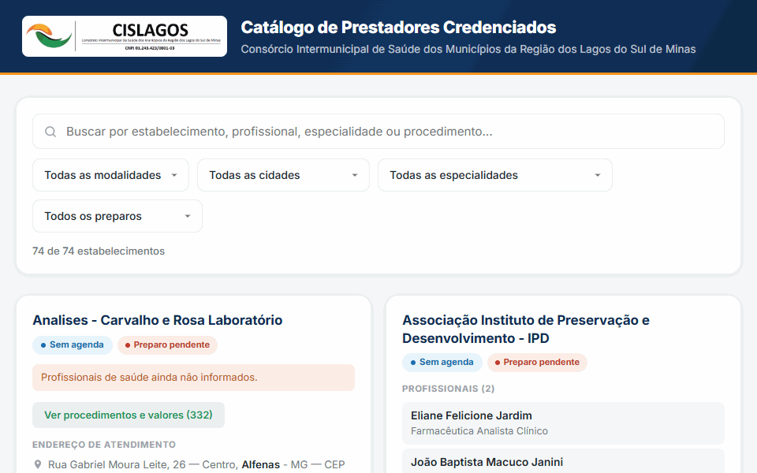
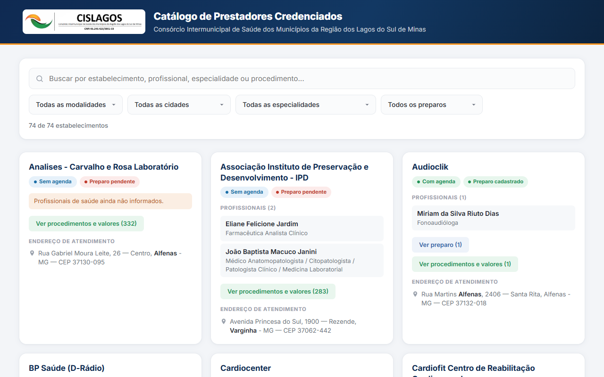
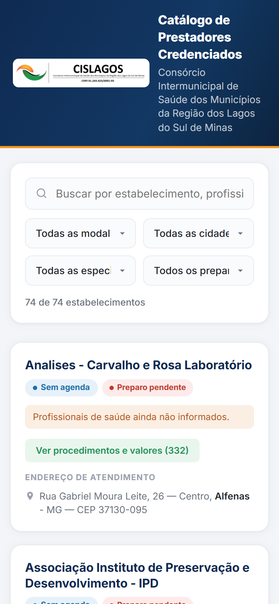

# Catálogo de Prestadores · CISLAGOS

**Ferramenta em uso** pela equipe de agendamento do CISLAGOS, o consórcio intermunicipal de saúde dos municípios da região dos Lagos do Sul de Minas.

**[Ver o catálogo no ar](https://catalogo-agendamento.vercel.app)**



## O problema

Para marcar um exame ou consulta, a equipe precisava saber em qual prestador credenciado aquele procedimento é feito, em qual cidade, por qual profissional, quanto custa e qual o preparo do paciente. Essas informações estavam em planilhas, PDFs de edital e pastas de rede separadas.

## A solução

Um catálogo único, com busca, que responde isso em segundos:

| | |
|---|---|
| **74** estabelecimentos credenciados | **16** cidades |
| **167** profissionais, em **49** especialidades | **5.571** procedimentos com valor |
| **106** preparos de exame cadastrados | |

- **Busca livre** por estabelecimento, profissional, especialidade ou procedimento.
- **Filtros** por modalidade (com agenda, sem agenda, por solicitação), cidade, especialidade e situação do preparo.
- **Procedimentos e valores** de cada prestador numa janela com busca própria.
- **Preparo do exame** pronto para imprimir ou salvar em PDF e entregar ao paciente.
- **Avisos visíveis** de pendências, como preparo não cadastrado ou profissionais não informados.

<p align="center">
  
  &nbsp;
  
</p>

## Como foi feito

- HTML, CSS e JavaScript puros, sem framework e sem etapa de build.
- Os dados ficam em `data.js`, consolidados a partir das planilhas e dos documentos de credenciamento. A interface (`app.js`) monta os cartões, os filtros e as janelas a partir deles.
- Publicado na Vercel. Cada atualização de dados vira um commit e entra no ar sozinha.

## Rodar no computador

Basta abrir o `index.html` no navegador ou servir a pasta:

```bash
npx serve .
```

## Créditos

- **Cliente:** CISLAGOS – Consórcio Intermunicipal de Saúde dos Municípios da Região dos Lagos do Sul de Minas.
- **Desenvolvimento:** [Raphael Otávio](https://github.com/Phaaek013).

Os dados de prestadores, procedimentos e valores são do CISLAGOS. A marca pertence ao consórcio.
